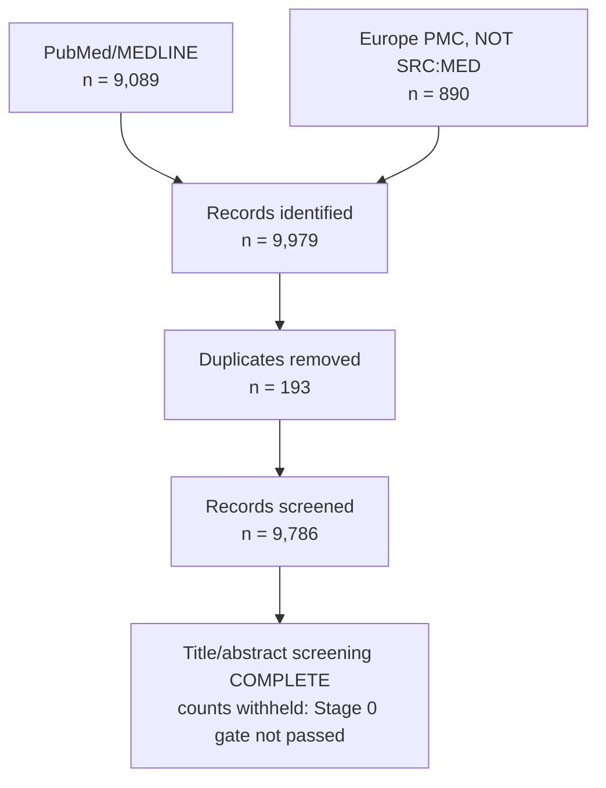

# PRISMA 2020 flow

Generated by `pipeline/render_prisma.py` from the committed count artefacts.
No number in this document was typed by hand: identification and deduplication
are read from `prisma_counts_combined_v3.csv`, and the screening row is produced by
the same gated function the manuscript calls.

Registration: OSF Registries [3xtf2](https://osf.io/3xtf2) · DOI
[10.17605/OSF.IO/3XTF2](https://doi.org/10.17605/OSF.IO/3XTF2).
Search reporting against all sixteen PRISMA-S items:
`PRISMA_S_search_report.md`.

---

## Identification

| source | n |
|---|---:|
| PubMed/MEDLINE | 9,089 |
| Europe PMC (`NOT SRC:MED`) | 890 |
| **total identified** | **9,979** |

(The deduplication table below starts from 9,978, which is this total after
the one PubMed-internal duplicate has already been removed.)

Embase, Web of Science and Cochrane CENTRAL were **not searched** — no
institutional access. Trial registries not yet searched. See
`protocol/amendments.md`, Amendment 1; the coverage cost is carried in
`METHODS.md` Section 11 rather than offset by a claim of equivalence.

## Deduplication

| step | identified | removed | remaining |
|---|---:|---:|---:|
| PubMed-internal | 9,089 | 1 | 9,088 |
| union with Europe PMC | 9,978 | 192 | **9,786** |

Deduplication by exact normalised DOI, then PMID, then fuzzy title (rapidfuzz
>= 95) requiring an identical first-author surname and a compatible publication
year. Records that both carry an identifier and disagree on it are not merged —
except for preprint pairs, which always disagree on DOI by construction
(Amendment 2).

192 records were removed across 190 merge groups, of which 184 joined records from different databases and 6 were within a single database. Every cross-source merge was inspected; the non-exact title matches differ only by casing, dash style, an added word, or a conference-abstract prefix. Each surviving record carries its `merged_from` provenance, so any merge can be audited individually.

### Screening — counts WITHHELD

9,786 records entered title/abstract screening. Every one has a recorded decision.

**The counts are not shown here, and that is deliberate.** The registered Stage 0 gate (protocol Section 5) is Cohen's kappa >= 0.75 between the investigator and the model, and it has not been passed:

> no agreement report at screening\agreement_sonnet.json. The registered Stage 0 gate is Cohen's kappa >= 0.75 between the investigator and the model (protocol Section 5). Until the investigator has screened the calibration sample blind, no kappa exists and no screening count may be reported.

This document is generated by calling the same gated function the manuscript would call. It has no path to a screening count that has not passed the gate, so a closed gate cannot be worked around by regenerating the figure. The decisions exist and are auditable in `screening/screening_decisions_sonnet.jsonl`; they are provisional until validated.

---

## Flow

## What this diagram does not yet show

Full-text screening, eligibility, and included studies are absent because
those stages have not run. A PRISMA diagram is normally read as a completed
account of a finished review; this one is a partial flow for a review in
progress, and is labelled as such rather than padded to look complete.

See `STATUS.md` for the full list of what has and has not been done.
